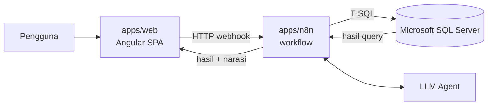

# SQL AI — Data Management Agent


Monorepo untuk **SQL AI Data Management**: agen AI yang menerima pertanyaan natural language, menerjemahkannya jadi SQL, mengeksekusi ke Microsoft SQL Server, dan mengembalikan hasil + narasi. Lengkap dengan auth, role-based access, chat history, dan konfirmasi untuk operasi destruktif.

## Fitur

- **Tanya data dengan bahasa natural** — pertanyaan diterjemahkan menjadi query T-SQL oleh agen AI, lalu hasilnya dijelaskan dalam bentuk narasi.
- **Autentikasi dan role-based access** — login dengan token, akses dibatasi sesuai peran pengguna.
- **Konfirmasi operasi destruktif** — perubahan data harus dikonfirmasi pengguna sebelum dijalankan.
- **Riwayat chat** — sesi percakapan disimpan, bisa dibuka ulang, dan dihapus.
- **Database explorer dan selector** — telusuri struktur database dan pilih database target.

## Arsitektur



- `apps/web` — Angular 22 SPA (chat, login, user management).
- `apps/n8n` — workflow n8n (auth, SQL agent, chat history, DB explorer).
- `database/` — SSMS SQL dumps untuk `TestDB` + `TestDB4`.

### Workflow n8n

| Workflow | Fungsi |
|----------|--------|
| Auth Service | Login dan penerbitan token |
| SQL AI Agent | Mengubah pertanyaan menjadi SQL, mengeksekusi, dan menyusun narasi |
| Database Explorer | Menelusuri struktur database |
| Database Selector | Memilih database target |
| Save Message / Update Message | Menyimpan dan memperbarui pesan chat |
| Get Sessions / Get History / Delete Session | Mengelola sesi dan riwayat chat |

## Struktur repo

```
sql-ai-data-management/
├── apps/
│   ├── web/              Angular SPA (+ Dockerfile, nginx.conf)
│   └── n8n/              n8n workflows + docker-compose
├── database/             SQL dumps (TestDB.sql, TestDB4.sql)
├── scripts/              helper script (apply-security-fixes.mjs)
├── .editorconfig
├── .gitignore
├── package.json          script root
├── README.md
└── SECURITY.md
```

## Prasyarat

- Node.js 22.22.3+ (LTS 22) dan npm 11+
- Microsoft SQL Server (lokal atau remote)
- (Opsional) Docker Desktop — untuk mode container

## Quick start (lokal Windows)

Skenario default: SQL Server 2022 lokal + Windows Authentication.

### 1. Clone dan install

```powershell
git clone https://github.com/fawzulmumin/sql-ai-data-management.git
cd sql-ai-data-management
cd apps\web && npm install && cd ..\..
```

### 2. Restore database

Import `database/TestDB.sql` dan `database/TestDB4.sql` via SSMS (File → Open → Execute) atau sqlcmd. Detail: [`database/README.md`](database/README.md).

### 3. Setup + jalankan n8n

```powershell
cd apps\n8n
copy .env.example .env
notepad .env         # isi N8N_ENCRYPTION_KEY (32-char random)

npm install -g n8n
n8n start
```

Buka `http://localhost:5678` dan ikuti **step 2–7** di [`apps/n8n/README.md`](apps/n8n/README.md#setup-lokal-di-windows-recommended):

1. Setup owner account n8n.
2. Enable SQL Server TCP + buat SQL login `n8n_user`.
3. Buat credentials MSSQL + LLM di n8n UI.
4. Replace credential ID di workflow JSON.
5. Import workflow via `npm run n8n:import`.
6. Link LLM credential + toggle **Active** semua workflow.

### 4. Seed user pertama

Tabel `dbo.users` yang di-restore sudah berisi user existing tapi password-nya tidak diketahui. Reset salah satu user dengan hash baru — lihat [`database/README.md#seed-user-pertama`](database/README.md#seed-user-pertama).

Verifikasi:
```powershell
$body = @{ username = "Nabil"; password = "<password-anda>" } | ConvertTo-Json
Invoke-RestMethod -Uri "http://localhost:5678/webhook/auth/login" -Method Post -ContentType "application/json" -Body $body
# success=True + token = login OK
```

### 5. Jalankan frontend

```powershell
cd apps\web
npm start
```

Buka `http://localhost:4200` → login dengan user yang Anda reset di step 4.

## Script root

| Script         | Deskripsi                                        |
| -------------- | ------------------------------------------------ |
| `web:install`  | Install dependency apps/web.                     |
| `web:start`    | Angular dev server (port 4200).                  |
| `web:build`    | Build production bundle apps/web.                |
| `web:test`     | Unit test Angular (Vitest).                      |
| `n8n:start`    | Jalankan n8n native (butuh install global dulu). |
| `n8n:import`   | Import semua workflow dari `apps/n8n/workflows/` (n8n harus stop). |
| `n8n:up`       | Jalankan n8n via Docker Compose.                 |
| `n8n:down`     | Stop container n8n.                              |
| `n8n:logs`     | Tail logs container n8n.                         |
| `db:apply`     | Jalankan SQL dumps via sqlcmd (edit instance name di package.json kalau beda). |

## Deployment

Frontend (`apps/web`) dapat di-build menjadi image Docker (nginx) memakai [`apps/web/Dockerfile`](apps/web/Dockerfile):

```bash
docker build -t sql-ai-web apps/web
```

n8n dijalankan terpisah (`npm run n8n:up` atau instalasi native). Atur `N8N_ENCRYPTION_KEY`, `JWT_SECRET`, dan
`N8N_CORS_ALLOW_ORIGIN` lewat environment (`apps/n8n/.env`) dan jangan pernah di-commit.

## Environment variables

- `apps/n8n/.env` (dari `.env.example`) — config startup n8n.
- `apps/web/src/environments/environment.ts` — base URL n8n untuk dev lokal (`http://localhost:5678/webhook`).
- `apps/web/src/environments/environment.production.ts` — base URL n8n untuk build production/Kubernetes (`/sql-ai/webhook`).

Credential SQL Server dan LLM API key **tidak** disimpan di `.env`. Dikonfigurasi via UI n8n (Credentials vault), dienkripsi pakai `N8N_ENCRYPTION_KEY`.

File `.env` dan `credentials.local.md` sudah di-gitignore. Jangan commit secret.

## Troubleshooting

Lihat juga [`apps/n8n/README.md#troubleshooting`](apps/n8n/README.md#troubleshooting) untuk detail lengkap.

| Gejala                                              | Fix                                                                 |
| --------------------------------------------------- | ------------------------------------------------------------------- |
| `n8n: command not found` setelah install            | Tutup/buka PowerShell lagi, atau cek `npm config get prefix` ada di PATH. |
| `SQLite package has not been found installed`       | Rebuild sqlite3 native binary — lihat apps/n8n/README. |
| `webhook not registered`                            | Workflow belum di-activate di UI.                                   |
| Tombol **Active** nolak di-toggle                   | Node ada yang merah → credential belum di-link.                     |
| `Login failed for user 'n8n_user'`                  | Password credential beda dengan SQL login. Re-type di n8n UI (jangan paste). |
| `Credential with ID "..." does not exist`           | ID credential di workflow JSON masih yang lama. Replace ID + re-import. |
| `{"message":"Error in workflow"}` dari webhook      | Pesan generik. Cek Executions tab di n8n UI untuk error asli.       |

## Security

Lihat [`SECURITY.md`](SECURITY.md) untuk status audit terakhir dan cara reporting vulnerability baru.

## Lisensi

MIT
